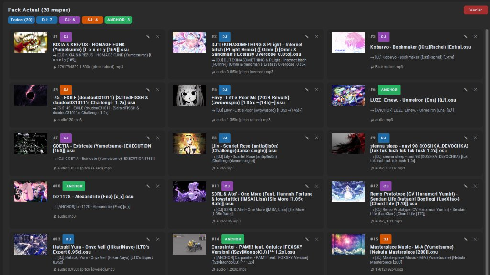

# osu! BeatmapPack Builder

Herramienta de escritorio para **Windows** diseñada para jugadores y mappers de **osu!** que quieren armar beatmap packs de forma rápida, ordenada y sin errores al subirlos.

---

## Descarga e instalación (sin saber programar)

1. Ve a la sección de [**Releases**](https://github.com/dnxlll/osu-beatmap-pack-builder/releases/latest).
2. Descarga el archivo **`osu-beatmap-pack-builder.exe`**.
3. Ábrelo con doble clic.
   - *(Si Windows SmartScreen muestra un aviso porque es una app indie sin firma digital, pulsa **Más información → Ejecutar de todas formas**).*
4. **Actualizaciones automáticas:** cuando salga una nueva versión, verás el botón verde **`⬆ Instalar vX.Y.Z`** arriba a la derecha; al pulsarlo, la app se actualiza y reinicia sola.

---

## ¿Qué hace esta app?

- **Detecta tu carpeta `Songs` automáticamente** (y te permite cambiarla con **"Cambiar Songs..."** si tienes osu! en otro disco).
- **Buscador instantáneo:** encuentra mapas por artista, título, mapper o ID, o **arrastra la carpeta del mapa** directamente a la app.
- **Clasificación por patrón:** etiqueta tus mapas como **DJ** (Dense Jack), **CJ** (Chordjack), **SJ** (Speedjack) o **ANCHOR**, con detección automática sugerida.
- **Galería visual de fichas:** mira cada mapa con su imagen de fondo, audio, patrón y vista previa del nombre final. Puedes **editar (`✎`)**, **quitar (`✕`)** o **filtrar por patrón** en cualquier momento.
- **Cortador de nombre:** elige si el título se recorta a **1 palabra**, **2 palabras**, **3 palabras** o **Completo**, con vista previa en vivo.
- **Limpieza y optimización automática para osu!:**
  - Elimina menciones de BPM/OD conservando rates (ej. `1.1x`, `0.95x`).
  - Optimiza imágenes de fondo a JPEG (máx. 1080p) para mantener el peso del pack bajo.
  - Trunca `Tags:` (>850 caracteres) y te avisa si un nombre supera los 160 caracteres para acortarlo fácilmente.

---

## Cómo crear tu primer Beatmap Pack (paso a paso)

### 1. Crea tu mapa base (`init_file`) en osu!
El `init_file` es un mapa plantilla que define el **Título del pack, Artista, Creador, Tags** y la **carpeta destino**.
1. En la sección **1. Carpeta Base**, pulsa **`⬇ MARATHON.mp3 (10m)`** y guarda el audio.
2. Arrastra ese `MARATHON.mp3` dentro de **osu!** para crear un mapa nuevo.
3. En el editor de osu!, llena los metadatos de tu pack (*Title, Artist, Creator, Tags*), ponle a la dificultad el nombre **`delete`** y guarda (**`Ctrl + S`**).

### 2. Selecciona la Carpeta Base en la app
1. En **1. Carpeta Base (`init_file`)**, busca la carpeta que acabas de crear (o usa **Examinar...**).
2. Si tiene varios `.osu`, selecciona tu plantilla `delete`.

### 3. Añade tus mapas
1. En **2. Buscar y Añadir Mapas**, busca una canción o arrastra su carpeta al panel.
2. Elige la dificultad `.osu`, selecciona el patrón (**DJ**, **CJ**, **SJ**, **ANCHOR** o Ninguno) y pulsa **"+ Añadir Dificultad al Pack"**.
3. Ajusta el **Cortador de Nombre** si quieres títulos más cortos o completos.

### 4. Genera el Pack
1. Pulsa **"⚡ Generar Pack de Mapas Final"**.
2. Al terminar, abre **osu!** (pulsa **`F5`** si es necesario para recargar) y borra la dificultad plantilla `delete` dentro del juego.

> Dentro de la app también tienes el botón **`? Guía`** arriba a la derecha para consultar estos pasos en cualquier momento.

---

## Licencia

Este proyecto está bajo la licencia **GNU GPL v3.0** — consulta el archivo [LICENSE](LICENSE) para más detalles.
